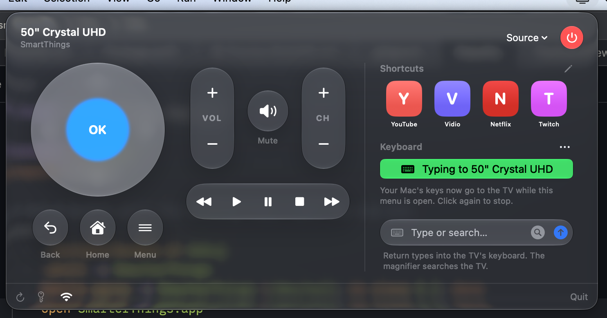

# SmarterThings

<p align="center">
  
</p>

A macOS menu bar remote for Samsung smart TVs. Click the TV icon in the menu bar to get a remote with a D-pad, volume and channel rockers, media keys, input sources, favorite app shortcuts, and your Mac's keyboard as a Bluetooth keyboard for the TV.

It talks to the TV directly over Wi-Fi and Bluetooth: no account, no cloud, no token.

> Not affiliated with or endorsed by Samsung. "Samsung" and "SmartThings" are trademarks of Samsung Electronics.

## Requirements

- macOS 26 or later (the UI uses Liquid Glass)
- Swift 6 toolchain. Xcode's Command Line Tools are enough; full Xcode isn't needed.
- A Samsung TV from 2016 or later (Tizen) on the same network as the Mac
- For the Bluetooth keyboard: Bluetooth on the Mac

## Install

1. Download the latest `SmarterThings-<version>.dmg` from the [Releases page](../../releases/latest), open it, and drag **SmarterThings** onto **Applications**.
2. Open SmarterThings from Applications. It appears as a TV icon in the menu bar, with no Dock icon.

The app is ad-hoc signed, not notarized by Apple, so the first launch on another Mac shows *"Apple could not verify SmarterThings…"*. To open it anyway, go to **System Settings › Privacy & Security** and click **Open Anyway** next to SmarterThings, or run:

```sh
xattr -dr com.apple.quarantine /Applications/SmarterThings.app
```

## Build from source

```sh
make run     # debug build, restart the app
make stop    # quit the app (or click Quit in the remote's footer)
make app     # optimized universal build → SmarterThings.app
make dmg     # → build/SmarterThings-<version>.dmg (+ .sha256)
make test    # run the tests
```

Set the version with `make dmg VERSION=1.1.0`. Release builds are universal (Apple Silicon and Intel).

## Releasing

Releases are built by GitHub Actions (`.github/workflows/release.yml`). Push a version tag:

```sh
git tag v1.1.0
git push origin v1.1.0
```

The workflow runs the tests on a macOS runner, builds `SmarterThings-1.1.0.dmg` with `make dmg`, and publishes a GitHub Release with the DMG, its `.sha256` file and auto-generated notes. The version comes from the tag, minus the leading `v`.

## How to use

### 1. First launch

Open SmarterThings. It finds your TV on the Wi-Fi by itself. Two one-time prompts:
1. **macOS** asks to allow SmarterThings to access the local network. Click Allow.
2. **The TV** asks whether to allow "SmarterThings (Mac)". Accept it with the physical remote.

If you have several Samsung TVs, pick one from the Wi-Fi menu in the footer. Your choice is remembered by the TV's own ID, not its IP, so it keeps working when the router gives the TV a new address. If no TV is found, the remote offers **Search Again** and a box for the TV's IP address. On the TV it's under Settings › General › Network › Network Status › IP Settings.

### 2. Remote buttons

| Control | Notes |
|---|---|
| Power (top right) | Red means on. Checks the TV's state on every click: on → off, standby → on (both with `KEY_POWER`, since a TV in standby still listens on Wi-Fi), no answer → Wake-on-LAN (needs **Power On with Mobile** on the TV). |
| D-pad, OK | Arrow keys, Return and Esc also work while the remote has focus. |
| Back, Home, Menu, VOL / CH, Mute, ⏪ ▶ ⏸ ⏹ ⏩ | All go straight to the TV over Wi-Fi. |
| Source (header) | Opens the TV's input menu. |

### 3. Type into Samsung's keyboard

Type in **Type on TV…** and press **Return** to send the text to whatever **Samsung keyboard** is open on the TV, e.g. Tizen's own search or the browser's address bar. YouTube and Netflix draw their own keyboards and ignore it; use the Bluetooth keyboard below for them.

### 4. Keyboard (type with your Mac's keyboard)

SmarterThings can act as a **Bluetooth keyboard** for the TV, which works in every app, including YouTube and Netflix:

1. In the **Keyboard** section, click **Connect to <your TV>**. SmarterThings finds the TV among the Mac's paired Bluetooth devices by its name. Use the ⌄ menu to pick another paired device, or **Pair a New Device…** if the TV isn't paired with this Mac yet (make it discoverable first). The first time, macOS asks for Bluetooth access.
2. Click **Start typing to TV**. While the menu is open, your Mac's key presses go to the TV, including Delete, Return and the arrows. Click again to stop. ⌘ shortcuts stay on the Mac.

The TV is remembered for next time. Quit other keyboard apps (e.g. KeyPad) first, since only one app can act as the Mac's keyboard at a time.

### 5. App shortcuts

Click ✎ next to **Shortcuts**. The app checks which known apps are installed on the TV and lists only those, using the TV's names. Tick up to four, then click ✓. Clicking a tile opens that app on the TV.

## How it works

Everything goes straight to the TV:

| | Used for |
|---|---|
| `wss://<tv-ip>:8002/api/v2/channels/samsung.remote.control` | Remote keys, typing into Samsung's keyboard |
| `http://<tv-ip>:8001/api/v2/` | TV name, ID, MAC address, power state; checking and opening apps |
| UDP broadcast, port 9 | Wake-on-LAN, for a TV that doesn't answer |
| SSDP (UDP multicast, port 1900) | Finding the TV on the network |
| Classic Bluetooth (HID) | The Mac as a Bluetooth keyboard |

The only credential is the pairing token the TV issues after you click "Allow".

### Samsung Tizen remote protocol

1. **Discovery.** SSDP `M-SEARCH` for `urn:samsung.com:device:RemoteControlReceiver:1` (older TVs) and `urn:dial-multiscreen-org:service:dial:1` (newer TVs, e.g. 2025 models), keeping only replies whose `SERVER` header says Samsung. Each reply's address is then asked for `http://<host>:8001/api/v2/`, which gives the TV's name and its stable `uuid:` ID; only `type: "Samsung SmartTV"` is kept. The TV chosen in the footer menu is matched by that ID. A manually entered IP is used only when discovery finds nothing, so a TV that gets a new IP from the router is found again automatically.
2. **Installed apps.** For each known app ID, `GET http://<tv-ip>:8001/api/v2/applications/<id>` returns 200 with the app's name if it's installed, or 404 if not. (`ed.installedApp.get` over the WebSocket isn't confirmed to work on newer firmware.)
3. **Connect (for typing).** A WebSocket to port 8002, with the app name base64-encoded in `name` and the saved pairing token in `token`. The TV replies `ms.channel.connect`; the first time, that reply includes the new token. The TV uses a self-signed certificate, which the app trusts only for the TV's own address. The TV drops idle connections, so a failed send reconnects once and retries.
4. **Typing.** `ms.remote.control` with `TypeOfRemote: "SendInputString"` and base64 text, then `SendInputEnd` to apply it.
5. **Keys.** `ms.remote.control` with `TypeOfRemote: "SendRemoteKey"`, `Cmd: "Click"` and a Samsung key code for every button (`KEY_UP`, `KEY_ENTER`, `KEY_RETURN`, `KEY_HOME`, `KEY_MENU`, `KEY_VOLUP`, `KEY_MUTE`, `KEY_CHUP`, `KEY_PLAY`, `KEY_FF`, `KEY_SOURCE`, `KEY_POWER`, …). The connection opens when the remote appears, and concurrent presses share one connection attempt, so the TV only asks "Allow" once. A ping every 10 seconds (3-second pong deadline) and a 1-second send deadline replace a stalled connection, so presses never pile up and arrive in a burst.
6. **Power.** `GET :8001/api/v2/` reports `PowerState` (`on` or `standby`), and its `wifiMac` is remembered with the TV. `PowerControl` reads it on every click, since `KEY_POWER` is a toggle: `on` → `KEY_POWER` (off); `standby` → `KEY_POWER` (on, because the TV keeps listening on port 8002 in standby); no answer → a Wake-on-LAN magic packet (6×`FF` + 16× the MAC) to UDP port 9.
7. **Apps.** `POST :8001/api/v2/applications/<id>` opens an app.

### Bluetooth keyboard (classic Bluetooth HID)

`BluetoothHIDKeyboard` uses IOBluetooth to act as a keyboard, following the Bluetooth HID Profile:

1. Publishes an SDP service record for a HID keyboard (`HIDKeyboardProtocol.serviceRecord`): service class `0x1124`, control PSM `0x11`, interrupt PSM `0x13`, subclass `0x40`, and the HID spec's boot keyboard report descriptor with report ID 1.
2. Temporarily sets the Mac's class of device to keyboard (`0x002540`).
3. Connects to the TV (found among the Mac's paired devices, or paired with macOS's device picker) and opens both L2CAP channels asynchronously.
4. Sends each key as a press report (`A1 01 <modifiers> 00 <usage> …`) followed by a release report on the interrupt channel, one write at a time in order (`HIDReportQueue`), keeping each report's bytes alive until IOBluetooth confirms the write. Mac key codes are mapped to HID usages by `MacKeyCodeMap`.
5. Answers the TV's control requests (SET_PROTOCOL, SET_IDLE, GET_REPORT, …) with HID handshakes.

### Code layout

Clean architecture: the UI depends on the core, and the core's domain doesn't depend on any network or storage code.

```
Sources/SmarterThingsCore/
  Domain/           RemoteKey, TVApp, TVPowerState, LocalTVDevice, HIDKeyStroke, and the
                    ports TVKeyPresser, TVKeyboard, TVAppOpener,
                    InstalledAppFinder, KeystrokeSender, TokenStore
  Application/      PowerControl (on / standby / unreachable)
  Infrastructure/   LocalTVRemote + LocalRemoteProtocol (keys, typing), LocalInstalledApps,
                    LocalTVDiscovery, SSDPDiscovery, TVHostFinder, WakeOnLAN,
                    BluetoothHIDKeyboard + HIDKeyboardProtocol + HIDReportQueue,
                    FileTokenStore
Sources/SmarterThings/  SwiftUI MenuBarExtra: views, view models, PopularApps (known app IDs)
Tests/SmarterThingsCoreTests/  Swift Testing, using fake HTTP transport and token stores
scripts/bundle.sh     builds SmarterThings.app (Info.plist, ad-hoc signature)
scripts/dmg.sh        packages it into a drag-to-Applications DMG
```

### Where data is stored

| What | Where |
|---|---|
| TV pairing token | `~/Library/Application Support/SmarterThings/local-tv-token` |
| Chosen TV (by ID), last-seen TV (name, IP, MAC for Wake-on-LAN), manually entered TV IP, Bluetooth TV address, favorite apps | app defaults (`com.mhdiiilham.SmarterThings`) |

The folder is readable only by your user account (0700, with files 0600). The token isn't kept in the Keychain because the app is ad-hoc signed: the Keychain treats every rebuild as a new app and asks for your password again.

## Limitations

- **Works on your home network.** The Mac and the TV must be on the same network; there's no control from elsewhere.
- **Power on from deep off needs a TV setting.** A TV in normal standby turns on with the power key over Wi-Fi. If it doesn't answer at all, Wake-on-LAN wakes it, which needs **Settings › General › Network › Expert Settings › Power On with Mobile** enabled on the TV.
- **Mute isn't read from the TV.** `KEY_MUTE` toggles, and the icon follows your presses, so it can drift if you use the physical remote.
- **No named inputs.** Source opens the TV's own input menu; the TV's local API doesn't list inputs by name.
- **Text typing only reaches Samsung's keyboard.** YouTube and Netflix ignore it; use the Bluetooth keyboard there.
- **Bluetooth typing only while the menu is open.** Key presses are captured from SmarterThings' own window; system-wide capture would need Input Monitoring permission.
- **Delete acts as Back in YouTube.** The keyboard sends HID Backspace, which YouTube's TV app treats as "back" while its own keyboard has focus.
- **Shortcuts only know listed apps.** The picker checks the app IDs in `Sources/SmarterThings/PopularApps.swift` against the TV. Add a missing app's Tizen ID to include it.
- **App tiles show letters, not icons.** The TV's icons aren't downloaded.
- **One TV pairing at a time.** Only one TV pairing token is stored, so switching between TVs makes the new TV ask "Allow" again.
- **Older TVs aren't supported.** Models from 2014–2015 use an older PIN-based pairing protocol.
- **It isn't notarized.** The app is ad-hoc signed, so other Macs show a Gatekeeper warning on first launch (see Install). Fixing that needs an Apple Developer ID ($99/year) and notarization.
- **SwiftUI `@State` isn't used.** In the macOS 27 SDK, `@State` is a macro whose plugin ships only with Xcode. The views use the `State` type directly so the app builds with Command Line Tools alone.

## Status

| Feature | Verified on a real TV (2025 Crystal UHD) |
|---|---|
| Finding the TV on Wi-Fi, remembering its MAC | ✅ |
| D-pad and volume over Wi-Fi | ✅ |
| Bluetooth keyboard | ✅ Typing works; Delete acts as Back in YouTube |
| Typing into Tizen's own search | ✅ |
| Checking installed apps (`/api/v2/applications/<id>`) | ✅ |
| Other keys over Wi-Fi (Back, Home, Menu, CH, Mute, media, Source) | ✅ |
| Opening apps over Wi-Fi (`POST /applications/<id>`) | ✅ |
| Power state (`on` / `standby`) | ✅ |
| Power on from standby with `KEY_POWER` | ✅ |
| Power on with Wake-on-LAN | ✅ |

The protocol messages and power decisions are covered by unit tests (`make test`).

## Contributing

Bug reports, TV compatibility reports and pull requests are welcome. See [CONTRIBUTING.md](CONTRIBUTING.md) and the [Code of Conduct](CODE_OF_CONDUCT.md). Please report security issues privately as described in [SECURITY.md](SECURITY.md).

## License

[MIT](LICENSE) © 2026 Muhammad Ilham
